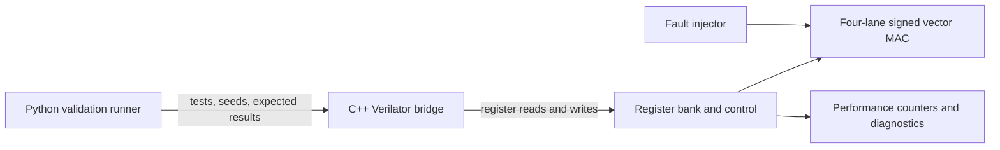

# Automated FPGA Accelerator Validation Framework

> **Status: In progress.** This repository is the starter scaffold for a student-scale, simulation-first pre-silicon validation project. The register interface and accelerator behavior below are proposed specifications and will be frozen before implementation.

## Project goal

Build a small signed vector multiply-accumulate (MAC) accelerator and an automated validation stack around it. The framework will configure the design through a memory-mapped register interface, compare results with a Python golden model, exercise directed and seeded-random tests, measure latency, inject repeatable faults, and capture diagnostic reports.

The project begins with a standalone signed multiplier so the arithmetic and simulator setup can be validated before adding the four-lane MAC, register bank, or automation. The first milestone is simulation only; FPGA deployment is optional later.

## Architecture



The initial multiplier testbench connects directly to the RTL and does not yet use the planned register interface.

## Provisional register map

The planned top-level interface uses 32-bit memory-mapped registers. `VECTOR_A` and `VECTOR_B` each pack four signed 8-bit lanes (`lane0` in bits `[7:0]`, `lane3` in `[31:24]`). The intended operation is `RESULT = ACCUMULATOR + sum(A[i] * B[i])`, with a signed 32-bit result. Exact bus handshakes, reset behavior, and error semantics will be specified before those blocks are implemented.

| Offset | Register | Access | Planned meaning |
|---:|---|:---:|---|
| `0x00` | `CONTROL` | R/W | `START` bit 0; `SOFT_RESET` bit 1 |
| `0x04` | `STATUS` | R | `BUSY` bit 0; `DONE` bit 1; `ERROR` bit 2 |
| `0x08` | `VECTOR_A` | R/W | Four packed signed 8-bit input lanes |
| `0x0C` | `VECTOR_B` | R/W | Four packed signed 8-bit input lanes |
| `0x10` | `ACCUMULATOR` | R/W | Signed 32-bit initial accumulator value |
| `0x14` | `RESULT` | R | Signed 32-bit MAC result |
| `0x18` | `CYCLE_COUNT` | R | Cycles for the most recently completed operation |
| `0x1C` | `ERROR_COUNT` | R | Count of detected device/protocol errors |
| `0x20` | `DEVICE_ID` | R | Fixed device identifier for bring-up checks |
| `0x24` | `VERSION` | R | RTL interface version |
| `0x28` | `FAULT_CTRL` | R/W | Test-only fault selection; disabled in normal operation |

## Planned repository structure

```text
meta-asic-validation-framework/
├── README.md
├── Makefile
├── requirements.txt
├── docs/
│   ├── architecture.md
│   ├── register_map.md
│   ├── validation_plan.md
│   └── bringup_log.md
├── rtl/
│   ├── signed_multiplier.sv       # Initial milestone
│   ├── vector_mac.sv
│   ├── register_bank.sv
│   ├── performance_counters.sv
│   ├── fault_injector.sv
│   └── accelerator_top.sv
├── sim/
│   └── tb_signed_multiplier.sv    # Initial self-checking testbench
├── firmware/
│   ├── include/device_driver.h
│   ├── device_driver.c
│   └── main.c
├── validation/
│   ├── golden_model.py
│   ├── device.py
│   ├── validate.py
│   └── tests/
├── configs/
│   └── default.yaml
├── results/
│   ├── raw/
│   └── plots/
└── scripts/
```

Only the initial RTL and simulation files exist at this stage. The remaining entries are planned.

## Run the initial simulation

From the repository root in a Linux shell with Icarus Verilog installed:

```bash
make sim-multiplier
```

Or compile and run it directly:

```bash
mkdir -p build
iverilog -g2012 -Wall -s tb_signed_multiplier -o build/tb_multiplier.vvp \
  rtl/signed_multiplier.sv sim/tb_signed_multiplier.sv
vvp build/tb_multiplier.vvp
```

Lint the initial module with Verilator:

```bash
make lint-multiplier
```

## Implementation checklist

- [x] Create repository scaffold and mark project as in progress.
- [x] Document planned architecture, register map, and directory layout.
- [x] Add a parameterized signed multiplier and self-checking boundary testbench.
- [ ] Confirm WSL 2 virtualization and install Ubuntu on the D: drive.
- [ ] Run the first Icarus simulation and Verilator lint; resolve all warnings.
- [ ] Freeze arithmetic widths, reset behavior, and the register-map contract.
- [ ] Implement the four-lane signed vector MAC and RTL-level tests.
- [ ] Add register bank, control/status behavior, and performance counters.
- [ ] Build the C++ Verilator bridge and Python golden model/test runner.
- [ ] Add directed, seeded-random, stress, timeout, and recovery tests.
- [ ] Add at least three repeatable fault modes and diagnostic capture.
- [ ] Produce machine-readable results and automated plots.
- [ ] Synthesize and document resource/timing trade-offs.
- [ ] Add FPGA bring-up only if a supported board is available.
- [ ] Record measured results and limitations before writing resume claims.

## Scope and claims

This is an educational **pre-silicon RTL validation** project. Simulation results are not silicon measurements. FPGA results, if added, will be labeled as FPGA validation and will not be described as post-silicon or production-fleet experience. No performance or coverage numbers are claimed until measured and recorded in this repository.
