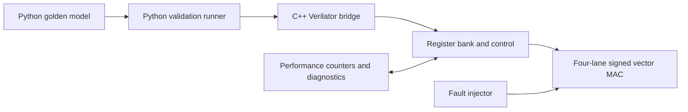

# Architecture

## Planned system

The register bank is the software/hardware contract. The validation runner will use a deterministic seed, write inputs, start an operation, poll status with a timeout, read the result and counters, compare against the golden model, and record enough information to reproduce any mismatch.

## Current implementation stage

The current RTL contains only a combinational signed multiplier with a self-checking testbench. It is an arithmetic/toolchain baseline, not the complete accelerator. The planned register interface, control FSM, four-lane MAC, counters, fault injection, and software bridge have not been implemented yet.
